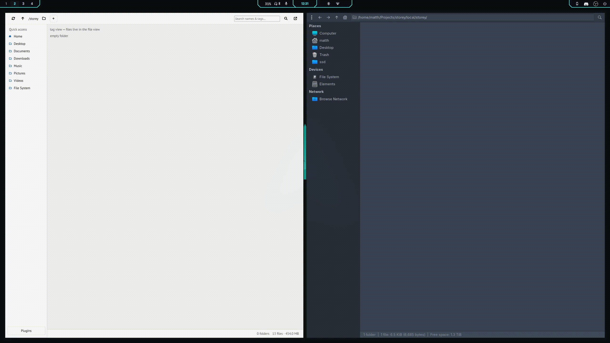

# storey



**In plain words:** imagine a folder full of movies, photos, or music
with messy names. You stick a few labels on each file — who made it,
what year it's from, what kind it is. Then storey sorts everything
into neat folders for you: ask for `year, director` and you instantly
get `2020/Nolan/movie.mkv`, `2020/Villeneuve/movie.mkv`, and so on.
Change your mind about the grouping and the folders rebuild in
seconds. Your files are never copied or duplicated — they rest safely
in a hidden vault and are only *linked* into place, and every change
can be undone. And unlike media servers, it sorts whatever you can
describe with labels — movies, music, photos, PDFs, documents.

Content-addressable storage (CAS) that creates **file-manager-friendly views**
of the CAS itself — for managing large file libraries.

This is a **monorepo** for 2 applications. The CLI is the source of
truth (CAS + index + views); the GUI is a thin client over it.
The behavioral reference lives in `.reference/` (do not copy from it
verbatim; reimplement per `docs/ARCHITECTURE.md`).

| App | Dir | Stack | Role |
| --- | --- | ----- | ---- |
| `storey` | `apps/cli` | Go | CLI. Source of truth: CAS + index + views. GUI shells out to it. |
| `storey-shared` | `crates/storey-shared` | Rust (lib) | Common UI layer: CLI subprocess driver, log parsing, index types. |
| `storey-core` | `crates/storey-core` | Rust (lib) | CLI logic: index, hashing, views, adoption. |
| `storey-gui` | `apps/gui` | Rust + cxx-qt (Qt6) | Graphical interface. Thin client over the CLI. |

## Layout

```text
.
├── apps/cli/        # Go module github.com/matyeusm/storey — `storey` binary
├── crates/            # Rust libs (`storey-shared` GUI layer, `storey-core` CLI logic)
├── apps/gui/        # Rust crate + cxx-qt — `storey-gui` binary (Qt6)
├── docs/            # architecture, CLI contract, plugins, releasing
├── scripts/         # dist helper script + size-limit check (sh, cross-platform)
├── .github/workflows/  # ci.yml, release.yml (win/mac/linux)
├── .reference/      # behavioral reference only, not a build input
├── mise.toml        # toolchains + tasks (mise-first workflow)
├── VERSION          # single source of truth for release version (0.1.0)
└── LICENSE          # MIT
```

## Requirements

- [mise](https://mise.jdx.dev/) — Go and Rust track `latest`
  in `mise.toml` and install automatically. **Qt6 (>= 6.6) is a system
  dependency** for the GUI (not via mise): install `qt6-base` +
  `qt6-declarative` from your OS package manager (see `apps/gui/README.md`).
- No other downloads needed for `build:cli` beyond `go` module
  and `cargo` crate fetches (`build:gui` additionally needs Qt6 dev files).

## Quickstart

```sh
mise install          # one-time toolchain install
mise run build:cli    # Go CLI -> apps/cli/bin/storey
mise run build:gui    # Qt GUI (needs system Qt6)
mise run build        # all
mise run test         # cli + shared + gui suites
mise run lint         # cli + shared + gui checks
```

Per-app details: `apps/cli/README.md`, `apps/gui/README.md`.

## Install a release

Download `storey-<os>.zip` from the
[releases](https://github.com/MatyeusM/storey/releases) page —
each holds the `storey` CLI and `storey-gui`:

- **Linux**: needs system Qt6 for the GUI (`sudo apt install
  qt6-base` or your distro's equivalent).
- **macOS**: `brew install qt` for the GUI (the GUI build is
  arm64; the bundled CLI is amd64 and runs under Rosetta).
- **Windows**: runs as-is — the needed Qt libraries ship inside
  the zip.

## Concept (from `.reference/`)

Inside a managed library folder:

- `.index.json` — created by `init` (the only thing `init` creates).
  Carries tags, hashes, and view state under a `storey` header object
  (schema v1, see `docs/CLI-CONTRACT.md`). Nested `.index.json` files
  are verified and adopted by `init`/`update`.
- `.files/` — the content store, created by `view`. Originals move here
  at `view` time under their display names (`_N` stem suffix on
  collision; hash-duplicates purged).
- `<View>/` — one folder per value of the chosen view key, containing links
  (symlink preferred, then hard link — never a copy) back into the store.
  A link that cannot be created is logged as a warning, not copied.

See `docs/ARCHITECTURE.md` for the reimplementation plan and open questions.

## Tasks

| Task | What it does |
| ---- | ------------ |
| `build` / `build:cli` / `build:gui` | Build all / one app |
| `test` / `test:cli` / `test:shared` / `test:gui` | Test all / one app |
| `lint` / `lint:cli` / `lint:shared` / `lint:gui` | Lint all / one app |
| `fmt` | `gofmt -w` + `cargo fmt` |
| `clean` | Remove build outputs |
| `dev:cli` / `dev:gui` | Run one app from source (`dev:gui` pins the fresh CLI via `--storey-bin`) |
| `build:gui-release` | Release-mode build |
| `dist:cli` | Cross-compile CLI matrix into `dist/` |

All task bodies are single-tool invocations (`&&`-chained) with
`run_windows` overrides where shells differ — same convention as
`.reference/mise.toml`.

## Releases (Windows / macOS / Linux)

- Tag `vX.Y.Z` → `.github/workflows/release.yml` builds CLI (`go build`
  matrix), GUI
  (`mise run build:gui-release` per OS with Qt installed per-OS),
  uploads artifacts + `SHA256SUMS` to a GitHub Release.
- `VERSION` file + per-app version sources (`apps/cli/internal/version`,
  `apps/gui/Cargo.toml`) must agree — see
  `docs/RELEASING.md`.

## License

MIT — see [LICENSE](LICENSE).
